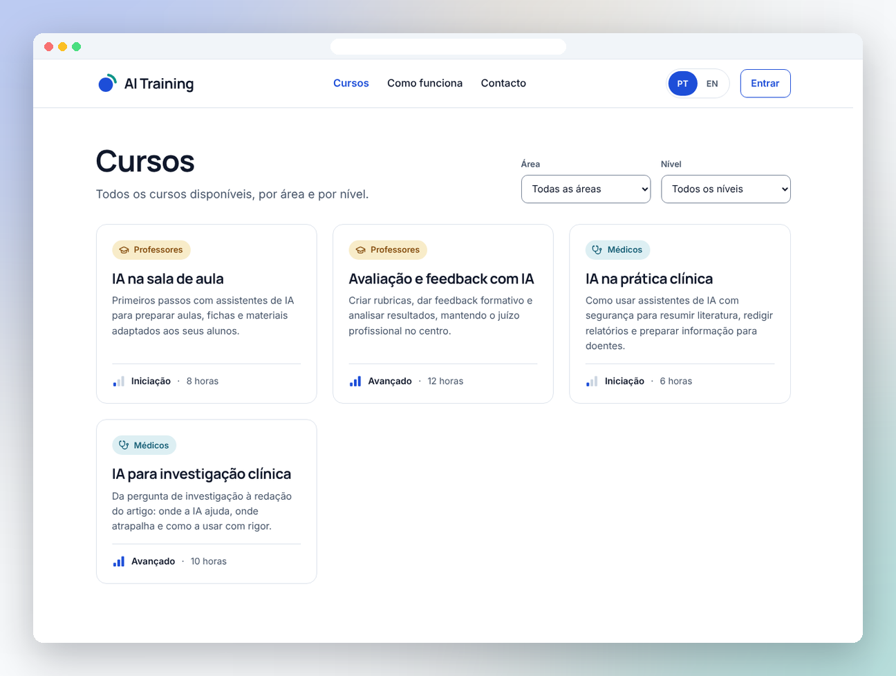
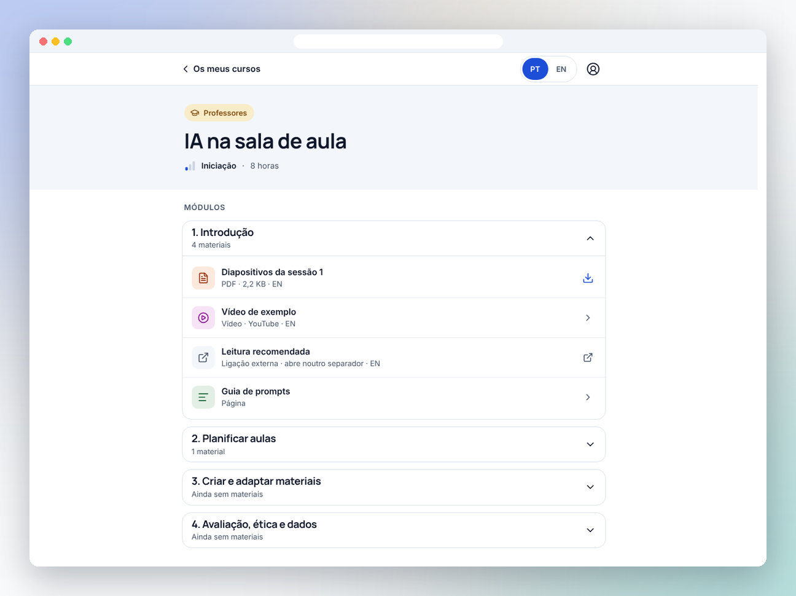
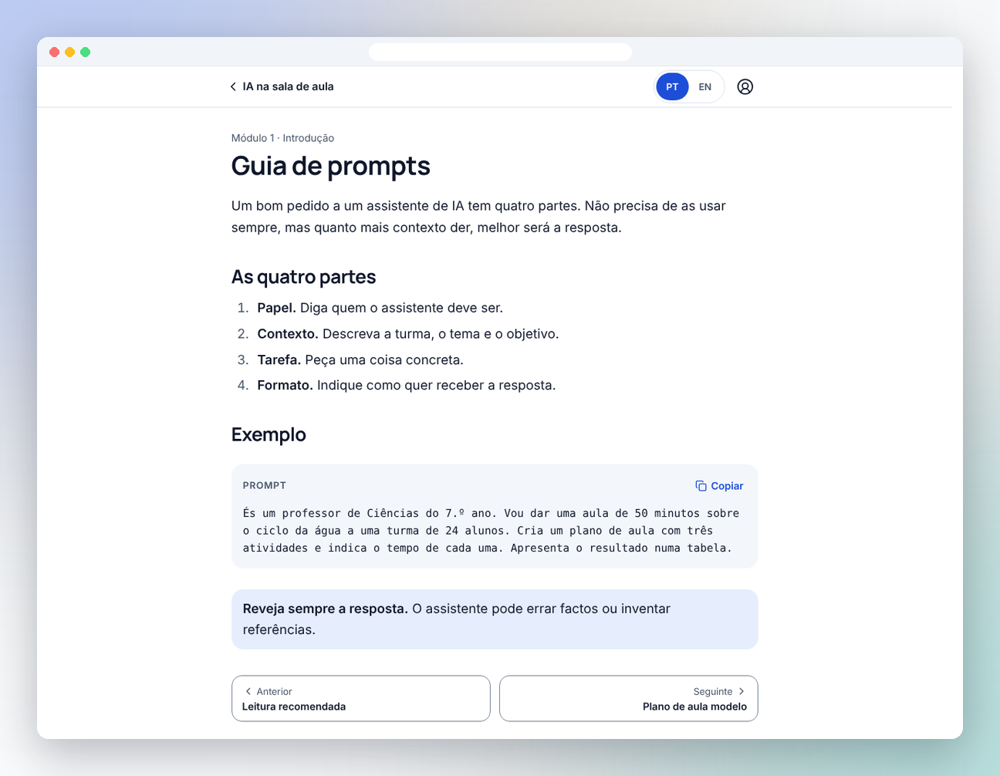
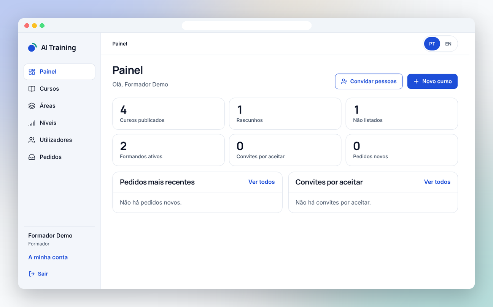
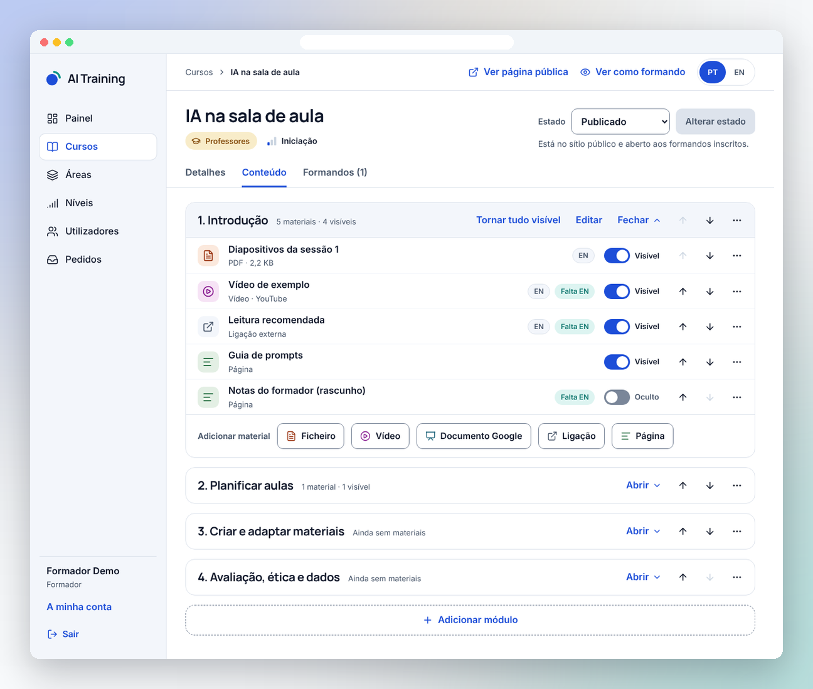
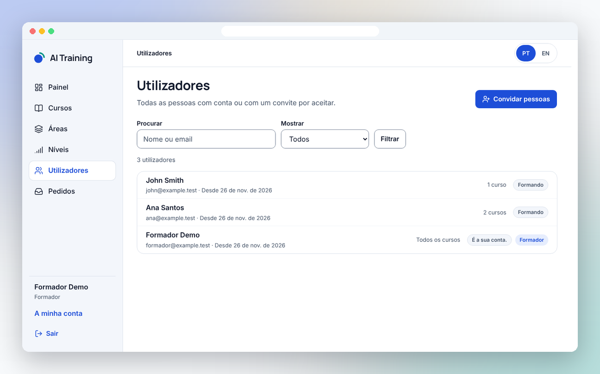
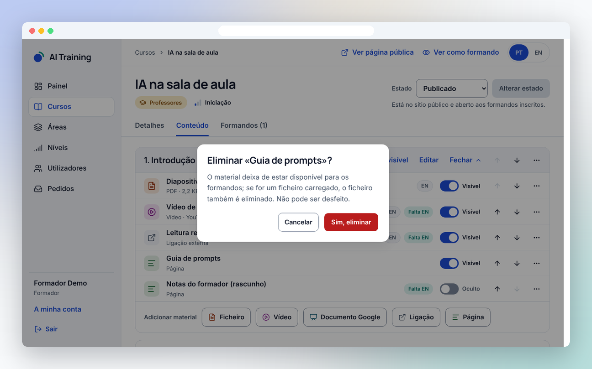
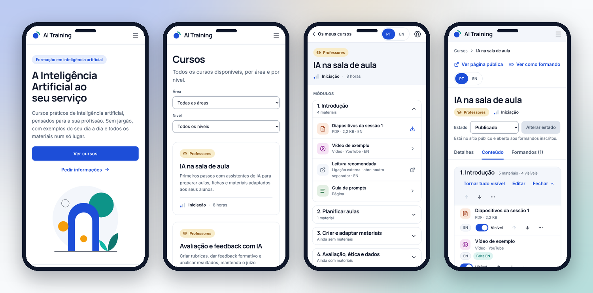
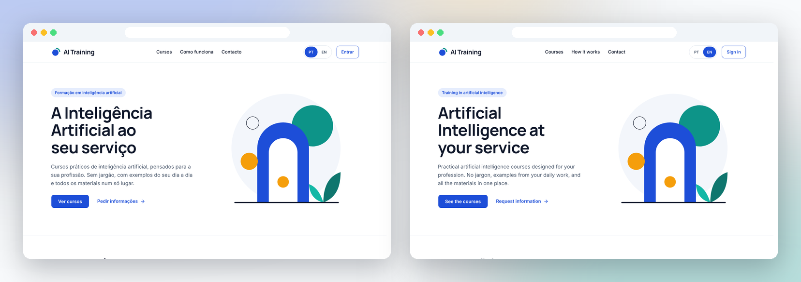

<div align="center">


<br>

# AI Training

### Practical AI courses, with every material in one place.

A closed learning platform: a public course catalogue, a calm space for learners, and a
back-office where trainers build courses and invite people. In Portuguese and English.

<br>

[](https://github.com/neteinstein/AI-Training/actions/workflows/ci.yml)


[**Take a look**](#take-a-look) &nbsp;·&nbsp; [**Features**](#what-it-does) &nbsp;·&nbsp;
[**Try it**](#try-it) &nbsp;·&nbsp; [**Technical guide**](TECH.md)

</div>

<br>

## 🎓 What it is

AI Training puts a whole course programme on one site. People find a course, ask for
information, get an invitation, and then find their slides, videos, readings and notes waiting
for them, on a laptop or on a phone.

Trainers run all of it themselves: no spreadsheets, no shared drives, no sending links around.

## 👥 Who it is for

|                                                   🌍 Visitors                                                   |                                                 🧑‍🎓 Learners                                                 |                                       🧑‍🏫 Trainers                                       |
| :-------------------------------------------------------------------------------------------------------------: | :---------------------------------------------------------------------------------------------------------: | :-------------------------------------------------------------------------------------: |
| Browse courses by **area** and **level**, read what each one covers, and ask for information from a short form. | Sign in once and see **only your courses**, with every material a click away, in the order the trainer set. | Create courses, add content, **invite people** and see who is enrolled, from one place. |

<a id="take-a-look"></a>

## 🖼️ Take a look

> The screenshots show the Portuguese interface, the default language. Every screen is also
> available in English.

### A public site that explains itself

<table>
<tr>
<td width="50%" valign="top"></td>
<td width="50%" valign="top">

**Find the right course**

Courses are grouped by **area** (a profession, such as teachers or doctors) and **level**
(beginner or advanced). Visitors filter by both, read a short summary, and see the length at a
glance.

Not on the list? A request form on the landing page lets anyone say which profession or course
they want. Trainers turn those requests into invitations.

</td>
</tr>
</table>

### A quiet place to learn

<table>
<tr>
<td width="50%" valign="top"></td>
<td width="50%" valign="top"></td>
</tr>
<tr>
<td valign="top">

**Modules, in order.** Each course is split into modules; each module holds slides, videos,
readings and pages. Everything for the course is on one screen.

</td>
<td valign="top">

**Pages worth reading.** Trainers write in Markdown. Prompts get a one-click **Copy** button, and
**Previous / Next** keep learners moving through the course.

</td>
</tr>
</table>

### A back-office trainers can use without a manual

<table>
<tr>
<td width="50%" valign="top"></td>
<td width="50%" valign="top"></td>
</tr>
<tr>
<td valign="top">

**A dashboard that answers "what needs me?"** Published courses, drafts, active learners, pending
invitations and new requests, with shortcuts to invite someone or start a course.

</td>
<td valign="top">

**Content you can rearrange.** Add materials, reorder them, and use the **Visible / Hidden** switch
to prepare a lesson without learners seeing it. A badge flags material that is missing in one
language.

</td>
</tr>
<tr>
<td width="50%" valign="top"></td>
<td width="50%" valign="top"></td>
</tr>
<tr>
<td valign="top">

**Everyone in one list.** Search people, see their role and courses, send a new access link, or
remove an account.

</td>
<td valign="top">

**Hard to break things.** Anything destructive asks first, and says what will happen.

</td>
</tr>
</table>

### On every screen size



Learners follow their courses on a phone, and trainers can run the back-office from one.
Nothing scrolls sideways, even on a 320 px screen.

### In two languages



Switch language at any time with the **PT / EN** toggle. Course names are written in both
languages. Emails, including invitations and password resets, arrive in each person's own
language.

<a id="what-it-does"></a>

## 🧩 What it does

### Every kind of material

| &nbsp; | Kind                | What learners get                                                    |
| :----: | ------------------- | -------------------------------------------------------------------- |
|   📄   | **Uploaded file**   | PDFs open in a built-in viewer; other files download                 |
|   🎬   | **Video**           | YouTube (cookie-free) or Vimeo, loaded when they press play          |
|   🗂️   | **Google document** | Slides, Docs, Sheets or a Drive file, embedded from the sharing link |
|   🔗   | **Link**            | Opens the other site in a new tab                                    |
|   📝   | **Text page**       | Written in Markdown, with copyable prompts and call-out boxes        |

### Invitations, not sign-ups

There is no public sign-up. A trainer invites someone by email, or copies a link to pass on by
hand, and that person chooses a password. Someone who already has an account just gets the new
courses.

### Courses with a life cycle

A course is a **draft** (trainers only), **published** (public site and enrolled learners) or
**unlisted** (hidden from the public site; enrolled learners keep access). A course with learners
cannot be deleted, only unlisted.

## 🔐 Built to be trusted

- **The database decides who sees what.** Rules live in Postgres, so a forgotten check in a page
  cannot expose anything.
- **Private files.** Uploads are only available to enrolled learners, through links that expire
  after a minute.
- **Invitation links survive email scanners.** A one-time link only counts when the person
  presses _Continue_.
- **Safe by default.** Strict security headers, sanitised Markdown, and embeds only from
  approved video and Google hosts.
- **Accessible.** Every main screen passes automated WCAG 2.1 A and AA checks, and the
  back-office works with the keyboard alone.
- **Tested for real.** Unit tests, database rules checked as visitor, learner and trainer, and
  browser journeys at desktop and phone sizes, on every change.

<a id="try-it"></a>

## 🚀 Try it in five minutes

You need [Node.js 22](https://nodejs.org) and [Docker](https://www.docker.com).

```bash
npm install
npm run db:start      # local Supabase: database, auth, storage, mail catcher
npm run env:local     # writes the local URL and keys to .env.local
npm run seed:dev      # demo accounts, enrolments and a sample PDF
npm run dev
```

Open <http://localhost:3000> and sign in as the demo trainer or a demo learner. The accounts and
everything else are in the [technical guide](TECH.md#getting-started).

## 📚 Documentation

| Read                                                           | For                                                                                     |
| -------------------------------------------------------------- | --------------------------------------------------------------------------------------- |
| [**TECH.md**](TECH.md)                                         | Stack, scripts, code layout, access rules, tests, and the step-by-step guide to go live |
| [Getting started](TECH.md#getting-started)                     | Running the whole thing on your computer                                                |
| [Going live](TECH.md#going-live)                               | Supabase, email, hosting and the first trainer                                          |
| [Database and access rules](TECH.md#database-and-access-rules) | Who can read and change what                                                            |

> [!NOTE]
> The interface text, the privacy notice and the demo catalogue are placeholders, to be replaced
> before the first class. [Going live](TECH.md#before-the-first-class) lists what to change.

<div align="center">

<sub>Built with Next.js and Supabase.</sub>

</div>
